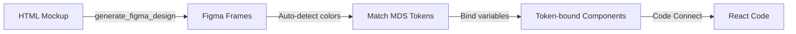

# Code-to-Design Token Binding Guide

## Overview

When using the HTML capture workflow (`generate_figma_design`), components are created in Figma with **hardcoded color and spacing values**. This guide shows how to bind MDS design tokens (variables) to make components theme-aware and design system compliant.

## Why Token Binding Matters

❌ **Without Token Binding (HTML Capture Default):**
- Colors: Hardcoded RGB values (e.g., `rgb(248,252,247)`)
- Spacing: Fixed pixel values
- Theme switching: Not supported
- Design system governance: Not compliant

✅ **With Token Binding:**
- Colors: Variable references (e.g., `Semantic/Status/Success/BG`)
- Spacing: Token-based values
- Theme switching: Automatic (Light/Dark modes)
- Design system governance: Fully compliant

## StatusCard Example

### Step 1: Captured Component (Before)

```
StatusCard Frame
├── Background Fill: rgb(248,252,247) ← Hardcoded green
├── Border Stroke: rgb(20,133,61)     ← Hardcoded green
├── Title Text
│   └── Fill: rgb(47,125,50)          ← Hardcoded green
└── Message Text
    └── Fill: rgb(47,125,50)          ← Hardcoded green
```

### Step 2: Token-Bound Component (After)

```
StatusCard Component/Success
├── Background Fill: Variable → Semantic/Status/Success/BG
├── Border Stroke: Variable → Semantic/Status/Success/Border
├── Title Text
│   └── Fill: Variable → Semantic/Status/Success/FG
└── Message Text
    └── Fill: Variable → Semantic/Status/Success/FG
```

## Automated Binding Script

### Using the Figma Plugin Console

1. **Open Your Figma File:**
   ```
   https://www.figma.com/design/uWlcofRor5Dik8LBnJbIjo?node-id=10852-2
   ```

2. **Open Plugin Console:**
   - Menu: `Plugins → Development → Open Console`
   - Or: Right-click → `Plugins → Development → Open Console`

3. **Run the Binding Script:**
   ```bash
   # Copy the script from:
   scripts/bind-statuscard-tokens.js
   
   # Paste into Figma Plugin Console
   # Press Enter
   ```

4. **Verify Output:**
   ```
   ✅ Found parent frame
   ✅ Found collection: Semantic Colors
   ✅ Status variables found
   🎨 Processing success card...
     ✅ Bound background to Semantic/Status/Success/BG
     ✅ Bound border to Semantic/Status/Success/Border
     ✅ Bound title text to Semantic/Status/Success/FG
   ...
   🎉 StatusCard token binding complete!
   ```

## Manual Token Binding (Alternative)

If the automated script doesn't work, bind variables manually:

### 1. Select Component Element

Click on the StatusCard/Success frame

### 2. Open Design Panel

Right panel → Design tab

### 3. Bind Background Color

1. Click **Fill** color swatch
2. Click **🔗 Variable** icon (top-right of color picker)
3. Search: `status success bg`
4. Select: `Semantic/Status/Success/BG`
5. Click **Apply**

### 4. Bind Border Color

1. Click **Stroke** color swatch
2. Click **🔗 Variable** icon
3. Search: `status success border`
4. Select: `Semantic/Status/Success/Border`
5. Click **Apply**

### 5. Bind Text Colors

1. Select Title text layer
2. Click **Fill** color swatch
3. Click **🔗 Variable** icon
4. Search: `status success fg` or `success text`
5. Select: `Semantic/Status/Success/FG` or `Semantic/Status/Success/Text`
6. Repeat for Message text

### 6. Bind Icon Color

1. Select icon shape (circle/vector)
2. Click **Fill** color swatch
3. Bind to same variable as text: `Semantic/Status/Success/FG`

### 7. Repeat for All Variants

- Success (green) → `Semantic/Status/Success/*`
- Warning (orange) → `Semantic/Status/Warning/*`
- Error (red) → `Semantic/Status/Error/*` or `Danger/*`
- Info (blue) → `Semantic/Status/Info/*`

## MDS Token Mapping

### Color Tokens Required

| Element | Token Name | Description |
|---------|------------|-------------|
| **Success** | | |
| Background | `Semantic/Status/Success/BG` | Light green background |
| Border | `Semantic/Status/Success/Border` | Green border |
| Text/Icon | `Semantic/Status/Success/FG` | Dark green text |
| **Warning** | | |
| Background | `Semantic/Status/Warning/BG` | Light orange background |
| Border | `Semantic/Status/Warning/Border` | Orange border |
| Text/Icon | `Semantic/Status/Warning/FG` | Dark orange text |
| **Error/Danger** | | |
| Background | `Semantic/Status/Error/BG` or `Danger/BG` | Light red background |
| Border | `Semantic/Status/Error/Border` or `Danger/Border` | Red border |
| Text/Icon | `Semantic/Status/Error/FG` or `Danger/FG` | Dark red text |
| **Info** | | |
| Background | `Semantic/Status/Info/BG` | Light blue background |
| Border | `Semantic/Status/Info/Border` | Blue border |
| Text/Icon | `Semantic/Status/Info/FG` | Dark blue text |

### Spacing Tokens (Optional)

If MDS has spacing variables:

| Element | Token Name | Value |
|---------|------------|-------|
| Card Padding | `Spacing/Layout/20` | 20px |
| Icon-Title Gap | `Spacing/Layout/12` | 12px |
| Title-Message Gap | `Spacing/Layout/12` | 12px |

## Verifying Token Bindings

### Visual Indicators

✅ **Correctly Bound:**
- Purple variable icon (🔗) next to color swatch
- Variable name shown in Design panel
- Tooltip shows "Bound to [Variable Name]"

❌ **Not Bound:**
- Solid color swatch (no icon)
- Hex value shown: `#f8fcf7`
- No tooltip

### Test Theme Switching

1. **Select Component**
2. **Right Panel → Mode Selector**
3. **Switch between modes:**
   - `Light` → Original colors
   - `Dark` → Inverted/adjusted colors
4. **Colors should change automatically** if bound correctly

## Converting to Component Set with Variants

After binding tokens, create a component set:

### 1. Select All 4 Card Components

Click each StatusCard component while holding Cmd/Ctrl:
- StatusCard/Success
- StatusCard/Warning  
- StatusCard/Error
- StatusCard/Info

### 2. Combine as Variants

- Right-click → `Combine as Variants`
- Or: Menu → `Object → Combine as Variants`

### 3. Configure Variant Property

1. Component set created with name `StatusCard`
2. Default property name: `Property 1`
3. Rename to: `Status`
4. Options automatically created: `Success`, `Warning`, `Error`, `Info`

### 4. Add Component Documentation

1. Select component set
2. Right panel → Properties
3. Add **Description:**
   ```
   Display status messages for success, warning, error, or info states.
   Use appropriate variant based on message severity.
   
   All colors bound to MDS Semantic tokens for theme support.
   ```

## Troubleshooting

### "Cannot find status variables"

**Problem:** Script can't find Semantic/Status/* variables

**Solutions:**
1. Check variable collection name (might be "MODE COLORS" instead of "Semantic")
2. Variables might be named differently (e.g., `Alert/Success/BG` instead of `Status/Success/BG`)
3. Run manual binding using search in color picker

### "setBoundVariable is not a function"

**Problem:** Older Figma API or wrong node type

**Solutions:**
1. Update Figma desktop app
2. Verify you're binding to a fill/stroke (not a frame itself)
3. Use manual binding method

### "Component looks wrong after binding"

**Problem:** Wrong variable selected

**Solutions:**
1. Check variable values in Design panel → Variables
2. Ensure BG variables are light colors (backgrounds)
3. Ensure FG/Text variables are dark colors (text)
4. Swap variables if inverted

### "Dark mode colors don't change"

**Problem:** Variables not set up with modes

**Solutions:**
1. Check that Semantic collection has Light/Dark modes
2. Ensure each variable has values for both modes
3. May need to create dark mode overrides in Figma

## Next Steps After Token Binding

### 1. Update Code Connect Mapping

```typescript
// src/figma/StatusCard.figma.tsx
const NODE_URL = '${LIB}?node-id=XXXXX-XX'; // Update with new component set node ID
```

Get node ID:
1. Select component set in Figma
2. Copy link: Right-click → `Copy link`
3. Extract node ID from URL: `?node-id=12345-67`

### 2. Publish Code Connect

```bash
npm run figma:publish
```

### 3. Verify in Figma Dev Mode

1. Open Figma file
2. Enable Dev Mode (top-right toggle)
3. Select StatusCard component
4. Check "Code" panel → Should show React code snippet
5. Verify variant switching works

### 4. Run Governance Checks

```bash
# Verify token compliance
npm run tokens:check

# Check role usage
npm run roles:check

# Validate contrast
npm run tokens:contrast:all
```

## Future: Automated Token Binding

**Ideal Workflow:**



This requires enhancing the MCP workflow to:
1. Detect hardcoded colors in captured design
2. Find closest matching MDS variables
3. Automatically bind variables during capture
4. Verify bindings and report mismatches

**Tracking:** Add this to MDS-Platform roadmap as "Automated Token Binding for Code-to-Design"

## Related Documentation

- [Token Request Process](../docs/TOKEN_REQUEST_PROCESS.md)
- [Figma Code Connect Guide](../docs/FIGMA_CODE_CONNECT_GUIDE.md)  
- [DESIGN.md](../DESIGN.md) - Full Figma integration rules
- [CLAUDE.md](../CLAUDE.md) - MDS Platform AI agent guide

## Summary

✅ **What You Learned:**
- HTML capture creates hardcoded values (quick but not DS-compliant)
- Token binding makes components theme-aware and maintainable
- Both automated (script) and manual (UI) approaches work
- Token binding is **critical** for design system governance

🎯 **Best Practice:**
Always bind MDS tokens after HTML capture to ensure design system compliance and enable theme switching.
