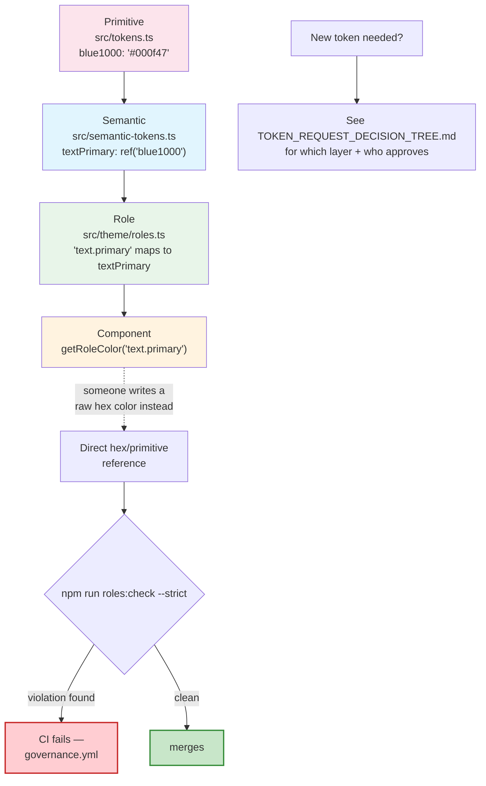

# Governance

This repo enforces four separate, interlocking governance systems. Each one exists to catch a different kind of drift, and each has its own detailed doc — this page is the map between them, with the visual flow each one is missing on its own.

```mermaid
flowchart LR
    A["Token & Role Governance"] -->|"a change lands safely"| D(("Merged"))
    B["CI Quality Gates"] --> D
    C["Documentation Governance"] --> D
    E["Branch Governance"] --> D

    A -.enforces.-> A1["getRoleColor&#40;&#41; only,<br/>no raw hex/primitives"]
    B -.enforces.-> B1["lint, types, tests,<br/>token diff, contrast"]
    C -.enforces.-> C1["no new root-level<br/>doc sprawl"]
    E -.enforces.-> E1["short-lived branches,<br/>never merge a stale one"]

    style A fill:#e1f5fe,stroke:#0277bd,stroke-width:2px
    style B fill:#f3e5f5,stroke:#7b1fa2,stroke-width:2px
    style C fill:#fff9c4,stroke:#f57c00,stroke-width:2px
    style E fill:#ffe0b2,stroke:#e64a19,stroke-width:2px
    style D fill:#c8e6c9,stroke:#388e3c,stroke-width:3px
```



---

## 1. Token & role governance

**What it protects:** that every color in the codebase traces back to an approved token, through the 3-tier architecture — never a hardcoded hex value.



**Needing a new token that doesn't exist yet** is a separate, upstream decision — design/approval, not enforcement. That flow (which layer, who signs off, how long it takes) is fully mapped in [`TOKEN_REQUEST_DECISION_TREE.md`](./TOKEN_REQUEST_DECISION_TREE.md), with the written process in [`TOKEN_REQUEST_PROCESS.md`](./TOKEN_REQUEST_PROCESS.md). This diagram is the other half: once a token *does* exist, what stops someone from bypassing it.

**Checked by:**
| Command | Checks |
|---|---|
| `npm run roles:check:strict` | Any component importing `tokens.*` or `semanticColors.*` directly, or using deprecated tokens |
| `npm run tokens:check` | Token build succeeds, no unauthorized primitive diff, DTCG export valid, WCAG contrast on every enforced pair |
| `npm run governance:ci` | `roles:check` + contrast, bundled into one strict report — this is what `governance.yml` runs in CI |

Full architecture, naming rule, and dark-mode mechanics: [`foundations/TOKENS.md`](./foundations/TOKENS.md).

---

## 2. CI quality gates

**What it protects:** that nothing broken — a failing test, a type error, an undocumented token change, a bad commit message — reaches `main`, regardless of which branch it was written on.


Push triggers are deliberately **not** `main`-only — this repo does substantial work directly on feature branches, so every branch gets real signal instead of nothing until merge.

**Reproduce any of this locally** before pushing: the exact command for each step is in [`Foundations/Testing`](http://localhost:6006/?path=/docs/foundations-testing--docs) (`npm run storybook`) and the README's [CI & Quality Gates](../README.md#ci--quality-gates) section, including the full failure cheatsheet.

---

## 3. Documentation governance

**What it protects:** against exactly what already happened once in this repo — ~70 one-off status reports and build summaries accumulating at the repo root because nothing told anyone where a new doc belonged. `docs:check-sprawl` is the mechanical backstop; the decision ladder below is what actually prevents a new doc from needing to be moved later.


The mechanical gate (`docs:check-sprawl`, run as part of `docs:lint` in every CI run) only catches the literal failure mode — a new `.md` file landing at repo root outside the five allowlisted files. It can't enforce "does an existing doc already cover this" or "has this doc gone stale" — those need judgment, which is what the ladder above is for. Full text version, with the actual list of examples this rule already fixed: [`CLAUDE.md` → Documentation Governance](../CLAUDE.md#documentation-governance).

---

## 4. Branch governance

Added 2026-09-22, after a branch from 2026-03-29 was found still open with
190 commits of `main` on top of it.

### The rule that matters most

**Never merge a branch older than the work it would touch. Cherry-pick from it
instead, then delete it.**

A merge tells git "combine these two histories". Git has no notion of *newer is
better* — it takes whatever each side holds. A branch that predates your fixes
will quietly revert them, and it does so **without a single conflict**, because
there is nothing to conflict with: the branch simply never knew the newer work
existed. A clean merge is not evidence of a safe merge.

`copilot/analyze-test-coverage` was the live example. Six months old, three
commits, `git merge-tree` reporting zero conflicts — and carrying old copies of
`src/tokens.ts`, `src/semantic-tokens.ts`, `_typography.scss` and ten `.scss`
files. Merging it would have silently undone a day's accessibility work,
including the fixes for text nobody could read. Three test files were
cherry-picked out of it instead; everything else was discarded.

### Lifetimes

| Branch | Expected life | Then |
|---|---|---|
| `feature/*`, `fix/*`, `chore/*` | **Hours to a few days** | Merge, or close |
| Anything untouched **30 days** | Stale | Close it. Reopening is cheap; merging six-month-old code is not. |
| `main` | Permanent | Protected by the `main-1` / `main-2` rulesets |

Long-lived branches don't rot in the way people expect. They don't grow *more*
conflicted — they grow more silently wrong. Every day `main` moves, the branch's
copy of a shared file becomes a more complete replacement of work it knows
nothing about.

### Before deleting any branch

Check whether it is merged, and say so out loud:

```bash
git merge-base --is-ancestor origin/<branch> origin/main && echo merged || echo "NOT merged"
git log --oneline origin/main..origin/<branch>   # what would be lost
```

**Merged** — safe to delete, nothing is lost.
**Not merged** — it holds commits that exist nowhere else. Either extract what
is worth keeping first, or get an explicit decision to discard it. Record the
SHA in the commit message; a deleted branch can be restored from its SHA, but
only if someone wrote it down.

### Why this is judgment, not a script

There is no gate for this and there shouldn't be. "Is this branch too old to
merge" depends on what it touches — a branch that only adds a new file is safe
at any age; one that edits `src/tokens.ts` is dangerous within a week. The
mechanical checks above tell you *what* a branch contains; deciding what that
means is the reviewer's job.

What *is* mechanical, and now in place: `main` is the trunk (it was abandoned
for five months, which is why side branches lived so long), and the `main-2`
ruleset requires a PR — a branch open six months shows up as a stale PR, whereas
a branch open six months with no PR is invisible.

---

## Where each system's detail lives

| System | This page has | Full detail |
|---|---|---|
| Token & role | Enforcement flow | [`foundations/TOKENS.md`](./foundations/TOKENS.md), [`TOKEN_REQUEST_PROCESS.md`](./TOKEN_REQUEST_PROCESS.md), [`TOKEN_REQUEST_DECISION_TREE.md`](./TOKEN_REQUEST_DECISION_TREE.md) |
| CI gates | Trigger + pipeline flow | [`Foundations/Testing`](http://localhost:6006/?path=/docs/foundations-testing--docs), README [CI & Quality Gates](../README.md#ci--quality-gates) |
| Documentation | Decision-ladder flow | [`CLAUDE.md` → Documentation Governance](../CLAUDE.md#documentation-governance), [`docs/README.md`](./README.md) |
| Branch | Lifetimes + the stale-merge rule | This page (§4) — there is no separate doc, and no gate; it is reviewer judgment backed by the `main-1`/`main-2` rulesets |
