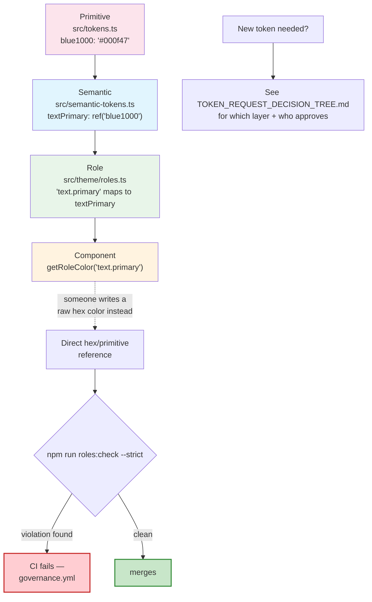
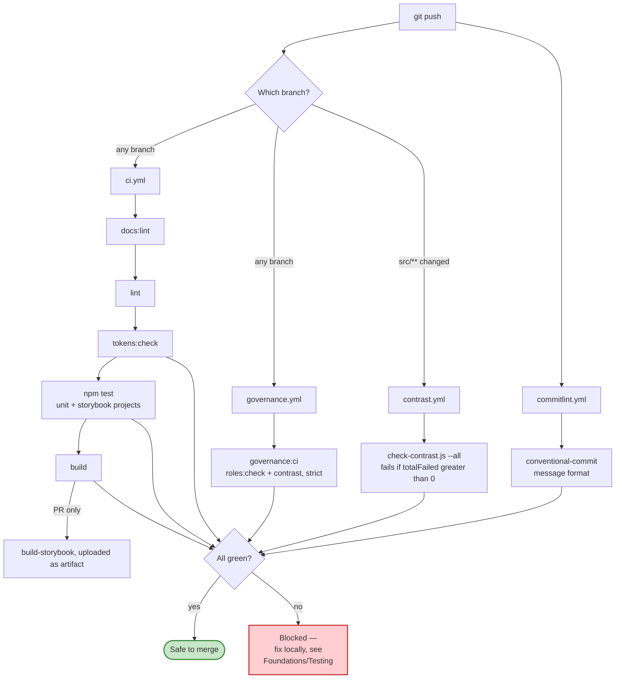
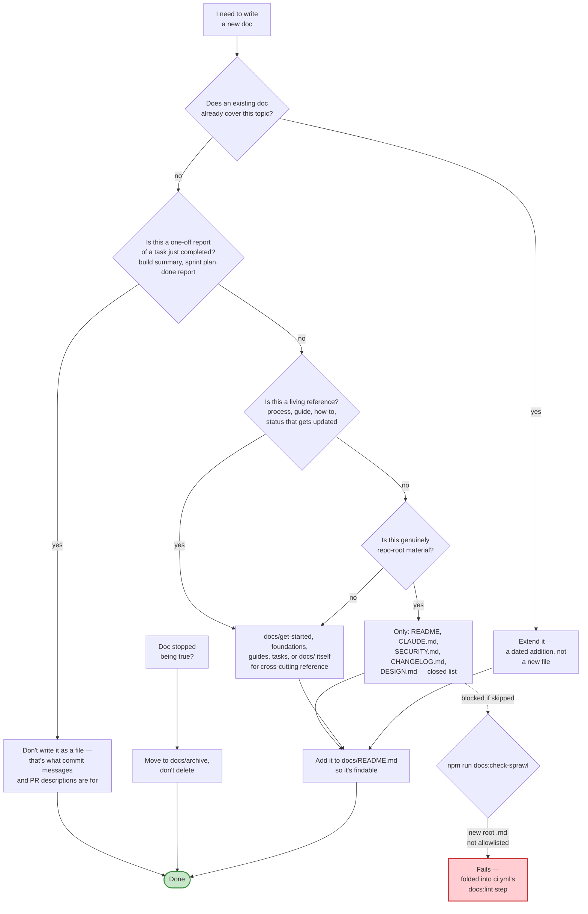

# Governance

This repo enforces three separate, interlocking governance systems. Each one exists to catch a different kind of drift, and each has its own detailed doc — this page is the map between them, with the visual flow each one is missing on its own.

```mermaid
flowchart LR
    A["Token & Role Governance"] -->|"a change lands safely"| D(("Merged"))
    B["CI Quality Gates"] --> D
    C["Documentation Governance"] --> D

    A -.enforces.-> A1["getRoleColor&#40;&#41; only,<br/>no raw hex/primitives"]
    B -.enforces.-> B1["lint, types, tests,<br/>token diff, contrast"]
    C -.enforces.-> C1["no new root-level<br/>doc sprawl"]

    style A fill:#e1f5fe,stroke:#0277bd,stroke-width:2px
    style B fill:#f3e5f5,stroke:#7b1fa2,stroke-width:2px
    style C fill:#fff9c4,stroke:#f57c00,stroke-width:2px
    style D fill:#c8e6c9,stroke:#388e3c,stroke-width:3px
```

---

## 1. Token & role governance

**What it protects:** that every color in the codebase traces back to an approved token, through the 3-tier architecture — never a hardcoded hex value.

**Needing a new token that doesn't exist yet** is a separate, upstream decision — design/approval, not enforcement. That flow (which layer, who signs off, how long it takes) is fully mapped in [`TOKEN_REQUEST_DECISION_TREE.md`](./TOKEN_REQUEST_DECISION_TREE.md), with the written process in [`TOKEN_REQUEST_PROCESS.md`](./TOKEN_REQUEST_PROCESS.md). This diagram is the other half: once a token *does* exist, what stops someone from bypassing it.

**Checked by:**
| Command | Checks |
|---|---|
| `npm run roles:check:strict` | Any component importing `tokens.*` or `semanticColors.*` directly, or using deprecated tokens |
| `npm run tokens:check` | Token build succeeds, no unauthorized primitive diff, DTCG export valid, WCAG contrast on every enforced pair |
| `npm run governance:ci` | `roles:check` + contrast, bundled into one strict report — this is what `governance.yml` runs in CI |

Full architecture, naming rule, and dark-mode mechanics: [`foundations/TOKENS.md`](./foundations/TOKENS.md).

---

## 2. CI quality gates

**What it protects:** that nothing broken — a failing test, a type error, an undocumented token change, a bad commit message — reaches `main`, regardless of which branch it was written on.

Push triggers are deliberately **not** `main`-only — this repo does substantial work directly on feature branches, so every branch gets real signal instead of nothing until merge.

**Reproduce any of this locally** before pushing: the exact command for each step is in [`Foundations/Testing`](http://localhost:6006/?path=/docs/foundations-testing--docs) (`npm run storybook`) and the README's [CI & Quality Gates](../README.md#ci--quality-gates) section, including the full failure cheatsheet.

---

## 3. Documentation governance

**What it protects:** against exactly what already happened once in this repo — ~70 one-off status reports and build summaries accumulating at the repo root because nothing told anyone where a new doc belonged. `docs:check-sprawl` is the mechanical backstop; the decision ladder below is what actually prevents a new doc from needing to be moved later.

The mechanical gate (`docs:check-sprawl`, run as part of `docs:lint` in every CI run) only catches the literal failure mode — a new `.md` file landing at repo root outside the five allowlisted files. It can't enforce "does an existing doc already cover this" or "has this doc gone stale" — those need judgment, which is what the ladder above is for. Full text version, with the actual list of examples this rule already fixed: [`CLAUDE.md` → Documentation Governance](../CLAUDE.md#documentation-governance).

---

## Where each system's detail lives

| System | This page has | Full detail |
|---|---|---|
| Token & role | Enforcement flow | [`foundations/TOKENS.md`](./foundations/TOKENS.md), [`TOKEN_REQUEST_PROCESS.md`](./TOKEN_REQUEST_PROCESS.md), [`TOKEN_REQUEST_DECISION_TREE.md`](./TOKEN_REQUEST_DECISION_TREE.md) |
| CI gates | Trigger + pipeline flow | [`Foundations/Testing`](http://localhost:6006/?path=/docs/foundations-testing--docs), README [CI & Quality Gates](../README.md#ci--quality-gates) |
| Documentation | Decision-ladder flow | [`CLAUDE.md` → Documentation Governance](../CLAUDE.md#documentation-governance), [`docs/README.md`](./README.md) |
