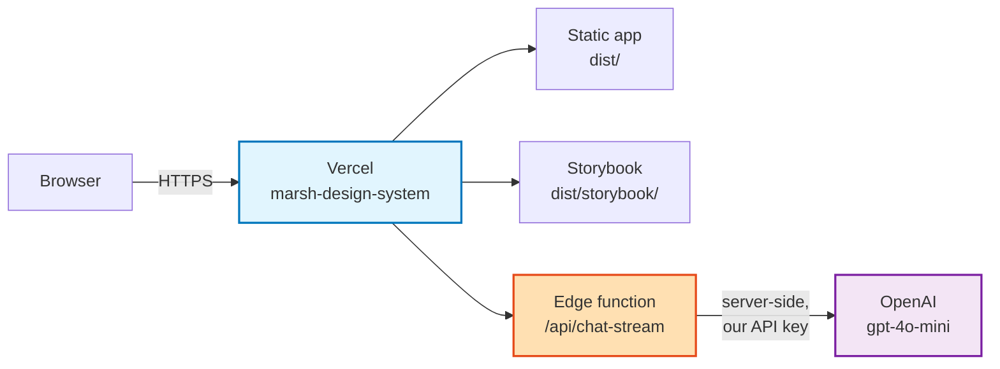

# Operations

**Audience:** whoever is on the hook when this breaks — not the person learning the token system. For that, start at [`docs/README.md`](./README.md).

This page answers three questions: *what is actually running*, *how do I change it safely*, and *what do I do when it breaks*. Every procedure here has been executed, not imagined; where something is a known weakness it says so rather than being left out.

---

## 1. What is running



| Thing | Where | Notes |
|---|---|---|
| App | `https://marsh-design-system.vercel.app/` | Static Vite build, served from `dist/` |
| Storybook | `/storybook/` | Built in the same Vercel pipeline. A SECOND path also exists — see below |
| Token artifacts | `/tokens.json`, `/theme.css`, `/tokens.tokens.json` | Tracked in git AND rebuilt each deploy |
| AI endpoint | `/api/chat-stream` | Vercel **Edge** runtime, `api/chat-stream.ts` |

**There is one environment.** Production and Preview share the same Vercel project and — see §5 — the same OpenAI key. There is no staging tier.

**`netlify.toml` and `docker-compose.yml` exist and are not used.** Neither reflects how this deploys. Don't follow them.

**A second Storybook deploy exists and appears to be broken.**
`.github/workflows/deploy-storybook.yml` runs on every push to `main` and
publishes Storybook to GitHub Pages via `actions/deploy-pages`. As of
2026-09-22 that site returns **404** and no `gh-pages` branch exists — so either
Pages is disabled on the repository or the workflow is failing. Nothing depends
on it (the working Storybook is the Vercel one at `/storybook/`), but it is a
workflow running on every push and producing nothing. Check the Actions tab and
either enable Pages or delete the workflow; leaving a permanently-failing job in
CI trains people to ignore red.

---

## 2. How a deploy happens

Push to `main` → Vercel's Git integration builds → live. There is no GitHub Actions deploy step; `vercel-deploy.yml.disabled` is inert.

```
installCommand:  npm ci
buildCommand:    npm run kb:build && npm run build && storybook build -o dist/storybook
outputDirectory: dist
Node:            22.x  (package.json engines: >=22 <23)
```

**The order of that build command matters and is not arbitrary.** `kb:build` generates `api/_data/knowledge-base.json`, which `api/chat-stream.ts` imports. `npm run build` starts with `tsc -b`, which typechecks that import. Generate before you typecheck, or every build fails — see §4.1, which is exactly what happened.

Typical duration **5–6 minutes**. Most of it is Vite plus a full Storybook build over ~97 story files.

### Deploying by hand

Rarely needed — pushing to `main` is the path. If you must:

```bash
npx vercel --prod        # from a clean checkout on main
```

The `npm run deploy` scripts predate the Git integration. They still work but bypass it, so the dashboard's deployment history won't match what's live. Prefer a push.

---

## 3. Rollback

Vercel keeps every previous deployment. Rolling back is **promoting an old one**, not reverting code:

```bash
npx vercel ls marsh-design-system        # find the last ● Ready deployment
npx vercel promote <deployment-url>      # make it production
```

This takes seconds and needs no build. **Do this first when production is broken**, then fix forward in git at a normal pace.

If the cause is a bad commit and you want it out of `main`:

```bash
git revert <sha>        # NOT reset — main is protected and shared
git push origin main
```

---

## 4. When it breaks

### 4.1 A deploy fails

Deploy failures **do not fail CI and do not take the site down** — Vercel keeps serving the last good build. That means they are silent. This exact situation ran for **four days** in September 2026 before anyone noticed.

```bash
npx vercel ls marsh-design-system                     # Ready / Error / Building
npx vercel inspect --logs <deployment-url> | tail -40 # the actual error
```

The log's last lines are the failure. Worked example — the four-day outage:

```
api/chat-stream.ts(6,23): error TS2307:
  Cannot find module './_data/knowledge-base.json'
```

…because the build generated that file *after* typechecking it. It passed locally because the file was already on disk from an earlier run, **and `tsc -b` is incremental so it never re-checked**. Reproduce a fresh-checkout build before blaming the platform:

```bash
rm api/_data/knowledge-base.json
npx tsc -b --force          # --force matters; without it, tsc trusts its cache
```

### 4.2 The site is up but serving stale content

Compare the deployed artifact against the repo:

```bash
curl -s https://marsh-design-system.vercel.app/tokens.json | python3 -c 'import sys,json;print(json.load(sys.stdin)["meta"])'
python3 -c 'import json;print(json.load(open("dist/tokens.json"))["meta"])'
```

Differing `version` or `generated` means the last successful deploy is older than `main` — go to §4.1.

### 4.3 The AI endpoint is misbehaving

```bash
# Is it up at all? 400 on an empty body is correct — it means it's alive.
curl -s -o /dev/null -w '%{http_code}\n' -X POST \
  https://marsh-design-system.vercel.app/api/chat-stream \
  -H 'Content-Type: application/json' -d '{}'
```

| Symptom | Likely cause |
|---|---|
| `500 OpenAI API key not configured` | `OPENAI_API_KEY` missing from Vercel env |
| `429 Too many requests` | Rate limit tripped — 15/min per IP, see §5 |
| `400` with a message | Input cap hit: question > 2,000 chars, or history > 12 turns / 12,000 chars |
| CORS error in a browser | Origin isn't allowlisted — see `api/_lib/guard.ts` |

### 4.4 CI is red

`npm test` runs **both** Vitest projects — unit *and* the Storybook browser suite, which includes axe accessibility checks. A red CI is often an accessibility regression, not a broken unit test.

```bash
npm test                                   # exactly what CI runs
npx vitest run --project storybook <file>  # narrow it down
```

---

## 5. Known weaknesses

Listed because a gap you know about is manageable and one you don't is not.

| Weakness | Impact | Fix |
|---|---|---|
| **Secrets in git history** | `.env` was committed Oct 2025 – Sep 2026 with live OpenAI and Figma keys. Still readable at `6515c4c9`, `ff46b8b6`, `364c5bf1`. Repo access = key access. | Rotate all three. Scrubbing history is cleanup, not a substitute |
| **One key across environments** | `OPENAI_API_KEY` is set for Preview *and* Production with the same value — every PR preview spends production budget | Separate keys per environment |
| **No spend ceiling** | Rate limiting caps request *frequency*, not monthly cost | Set a hard usage limit on the OpenAI key |
| **Rate limiter is per-isolate** | Edge functions run as many short-lived isolates; the counter lives in module scope, so it resets and an attacker spread across isolates exceeds 15/min | Needs shared state — Vercel KV, Upstash, or a WAF rule. See the note in `api/_lib/guard.ts` |
| **No alerting** | Failed deploys and spend spikes are both silent | Vercel → Settings → Notifications; OpenAI usage alerts |
| **No staging** | Nothing between a laptop and production | A second Vercel project, or Preview with its own credentials |
| **Bus factor of one** | `.github/CODEOWNERS` names a single owner on every path, as its own comment observes | Add a second owner |

---

## 6. Routine commands

```bash
npm ci                      # install exactly the lockfile
npm run dev                 # app, :5173
npm run storybook           # component workshop, :6006
npm test                    # everything CI runs — unit + storybook/axe
npm run build               # kb:build is NOT included; see §2
npm run release -- --release-as minor   # see CONTRIBUTING → Releases
```

Full gate list and what each one guards: [`GOVERNANCE.md`](./GOVERNANCE.md).

---

## See also

| For | Read |
|---|---|
| Contributing, branches, releases | [`CONTRIBUTING.md`](./CONTRIBUTING.md) |
| The four governance systems | [`GOVERNANCE.md`](./GOVERNANCE.md) |
| Application security posture | [`../SECURITY.md`](../SECURITY.md) |
| Getting started as a developer | [`get-started/DEVELOPERS.md`](./get-started/DEVELOPERS.md) |
