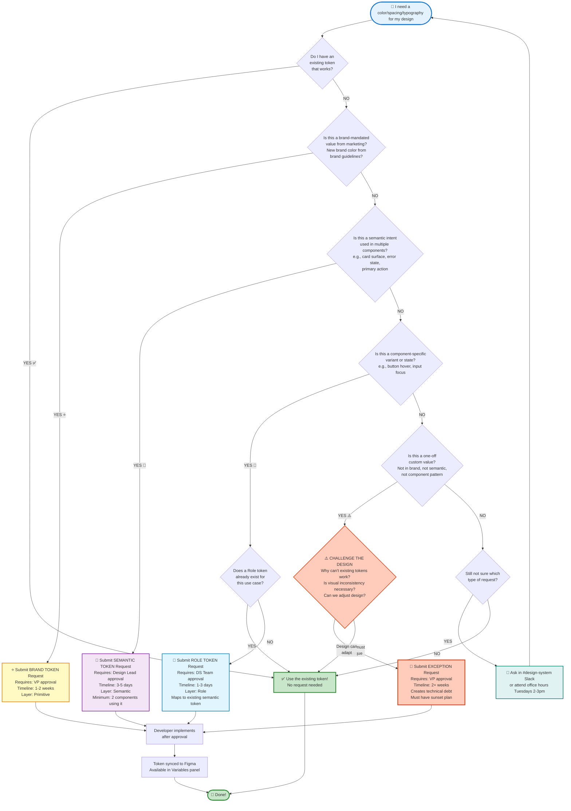

# Token Request Decision Tree (Visual)

This flowchart helps you decide whether you need a new token and which type to request.

## Interactive Flowchart

## Quick Reference Decision Matrix

| Question | Answer | Action |
|----------|--------|--------|
| **Existing token works?** | ✅ YES | Use it! No request needed |
| **Brand-mandated value?** | ⭐ YES | [Brand Token Request](../.github/ISSUE_TEMPLATE/token-request-brand.md) (VP approval) |
| **Semantic intent, 2+ components?** | 🎨 YES | [Semantic Token Request](../.github/ISSUE_TEMPLATE/token-request-semantic.md) (Design Lead) |
| **Component-specific state/variant?** | 🔧 YES | [Role Token Request](../.github/ISSUE_TEMPLATE/token-request-role.md) (DS Team) |
| **One-off custom value?** | 🚨 YES | Challenge design first, or [Exception Request](../.github/ISSUE_TEMPLATE/token-request-exception.md) (VP approval) |
| **Still not sure?** | 💬 | Ask in `#design-system` Slack or attend office hours |

---

## Examples by Type

### ⭐ Brand Token Example
**Scenario:** Marketing launched "One Marsh" rebrand with new navy (`#002c77`)  
**Request:** Brand Token for `marshNavy`  
**Approval:** VP + brand guidelines attached  
**Layer:** Primitive → Semantic → Role  
**Timeline:** 1-2 weeks

---

### 🎨 Semantic Token Example
**Scenario:** Dashboard, Reports, and Profile pages need elevated card backgrounds  
**Request:** Semantic token `surface.card.elevated`  
**Components:** Card (Dashboard), ReportCard (Reports), ProfileCard (Profile) — 3 components  
**Light:** `neutral50`, Dark: `neutral900`  
**Approval:** Design Lead  
**Timeline:** 3-5 days

---

### 🔧 Role Token Example
**Scenario:** Ghost button missing active (pressed) state  
**Request:** Role token `interactive.button.ghost.active`  
**Maps to:** `interactive.tertiary.pressed` (semantic already exists)  
**Component:** Button (ghost variant, `:active` pseudo-class)  
**Approval:** DS Team  
**Timeline:** 1-3 days

---

### 🚨 Exception Example (Discouraged)
**Scenario:** CEO requested custom gradient for executive dashboard hero  
**Request:** Exception for `linear-gradient(135deg, #012a5c 0%, #004080 100%)`  
**Usage:** Executive dashboard page hero only (1 instance)  
**Justification:** Executive mandate, does not fit brand token system  
**Sunset Plan:** Remove when One Marsh rebrand launches Q1 2027  
**Approval:** VP (required), Design Lead, Engineering Lead  
**Timeline:** 2+ weeks  
**Technical Debt:** Yes, tracked in Jira

---

## Pre-Request Checklist

Before submitting any token request:

- [ ] **Searched Figma Variables panel** for existing tokens
- [ ] **Checked Storybook token browser** (`http://localhost:6006/?path=/docs/tokens`)
- [ ] **Asked in `#design-system` Slack** if unsure which token to use
- [ ] **Reviewed TOKEN_REQUEST_PROCESS.md** for detailed requirements
- [ ] **Identified which layer** the token belongs to (Primitive / Semantic / Role)
- [ ] **Have clear justification** for why existing tokens don't work
- [ ] **Defined dark mode value** (if semantic token)
- [ ] **Listed 2+ components** that will use it (if semantic token)

---

## Common Rejection Reasons

| Reason | What to Do Instead |
|--------|-------------------|
| **Token already exists** | Use existing token; update docs if usage is non-obvious |
| **One-off custom value** | Redesign to use system tokens or get VP approval for exception |
| **Wrong layer** | Should be semantic, not primitive (or vice versa) — resubmit |
| **Poor naming** | Review naming conventions in [TOKENS.md](./foundations/TOKENS.md) |
| **Single use case** | Semantic tokens need 2+ components — add more use cases or make it a role |
| **Missing dark mode** | Define `semanticDarkOverrides` value for dark theme |
| **Contrast failure** | Proposed color pair fails WCAG AA (4.5:1) — adjust values |
| **Figma mismatch** | Value doesn't exist in Figma variables — add to Figma first |

---

## Need Help?

- **Slack:** `#design-system` channel
- **Office Hours:** Tuesdays 2-3pm ET (token request Q&A)
- **Email:** design-system@marsh.com
- **Documentation:** [TOKEN_REQUEST_PROCESS.md](./TOKEN_REQUEST_PROCESS.md)

---

**Last Updated:** April 23, 2026  
**Version:** 1.0
