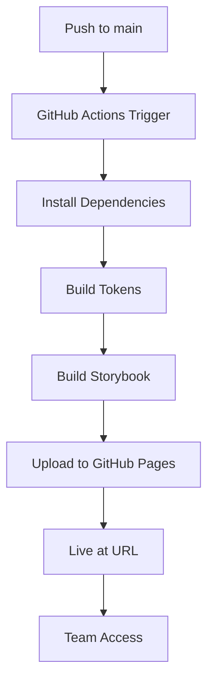

# Storybook Deployment Guide
**Staging Environment for Team Access**

---

## 🌐 Live URL Options

Choose one of these free hosting options:

**Netlify (Recommended):**
```
https://marsh-design-system.netlify.app
```

**Vercel:**
```
https://<company-storybook-host>
```

**GitHub Pages (Requires Pro):**
```
https://mmctech.github.io/MarshDesignSystem/
```

---

## 🆓 Free Deployment Options

### Option 1: Netlify (Recommended - 100% Free)

**Setup (5 minutes):**
1. Go to: https://app.netlify.com/
2. Click "Add new site" → "Import an existing project"
3. Connect to GitHub → Select "Marsh-Design-System"
4. Build settings:
   - **Build command:** `npm run build-storybook`
   - **Publish directory:** `storybook-static`
5. Click "Deploy site"

**Your URL will be:** `https://marsh-design-system.netlify.app`
(You can customize the subdomain)

**✅ Features:**
- Automatic deploys on push to `main`
- Branch previews for PRs
- Custom domains (free)
- Instant rollbacks
- Deploy logs

---

### Option 2: Vercel (Also 100% Free)

**Setup (5 minutes):**
1. Go to: https://vercel.com/
2. Click "Add New" → "Project"
3. Import "Marsh-Design-System" from GitHub
4. Build settings:
   - **Framework Preset:** Vite
   - **Build Command:** `npm run build-storybook`
   - **Output Directory:** `storybook-static`
5. Click "Deploy"

**Your URL will be:** `https://<company-storybook-host>`

**✅ Features:**
- Zero-config deployment
- Preview deployments for PRs
- Performance analytics
- Global CDN
- Instant rollbacks

---

### Option 3: GitHub Pages (Requires Paid Plan)

**Note:** GitHub Pages for private repositories requires GitHub Pro ($4/month).

If you upgrade to GitHub Pro:
1. Go to: https://github.com/mmctech/MarshDesignSystem/settings/pages
2. Under "Source", select: **GitHub Actions**
3. Push triggers automatic deployment

**Your URL will be:** `https://mmctech.github.io/MarshDesignSystem/`

---

## 📦 Manual Deployment (Alternative)

If you prefer manual control:

### Install gh-pages (First Time)
```bash
npm install --save-dev gh-pages
```

### Deploy Command
```bash
npm run storybook:deploy
```

This will:
1. Build Storybook locally
2. Push to `gh-pages` branch
3. Deploy to GitHub Pages

---

## 🔍 Verification

### Check Deployment Status

**GitHub Actions:**
1. Visit: https://github.com/mmctech/MarshDesignSystem/actions
2. Look for "Deploy Storybook to GitHub Pages" workflow
3. Check if it's green ✅ (success) or red ❌ (failed)

**Live Site:**
1. Wait 2-5 minutes after push
2. Visit: https://mmctech.github.io/MarshDesignSystem/
3. You should see your Storybook

---

## 📋 What Gets Deployed

### Pages Included:
- ✅ All Storybook documentation (35-Grid.mdx, etc.)
- ✅ All component stories (Button, Card, TextField, etc.)
- ✅ Grid system demos and examples
- ✅ Health checks (Environment, Grid, Smoke)
- ✅ Typography reference
- ✅ Color tokens and swatches
- ✅ MUI reference documentation

### Interactive Demos:
- ✅ Grid utilities (300+ examples)
- ✅ Component variations
- ✅ Responsive breakpoints
- ✅ Dark mode toggle
- ✅ Accessibility testing

**Note:** Live demos (`/grid-demo`, `/parallax-demo`) are NOT included in Storybook. Those are separate Vite app routes.

---

## 👥 Team Access

### Share With Your Team

Send this link:
```
https://mmctech.github.io/MarshDesignSystem/
```

**Features for Team:**
- 📖 Browse all components
- 🎨 See design tokens
- 📱 Test responsive behavior
- 🌓 Toggle dark mode
- 📋 Copy code examples
- 🔍 Search documentation

### Navigation Tips for Team:
1. **Sidebar:** Browse components and docs
2. **Canvas tab:** See live components
3. **Docs tab:** Read documentation
4. **Controls tab:** Interact with props
5. **Accessibility tab:** Check a11y

---

## 🔄 Update Process

### When You Make Changes:

**Automatic (Recommended):**
```bash
git add .
git commit -m "feat: update grid documentation"
git push
# Wait 2-5 minutes, site updates automatically
```

**Manual:**
```bash
npm run storybook:deploy
# Site updates immediately
```

---

## 🛠️ Troubleshooting

### Deployment Failed?

**Check Node Version:**
```bash
node -v  # Should be 22.x
```

**Clear Cache:**
```bash
npm run storybook:clean
npm run build-storybook
```

**Check Workflow Logs:**
1. Go to: https://github.com/mmctech/MarshDesignSystem/actions
2. Click failed workflow
3. Check error messages

### 404 Error on Live Site?

**Verify GitHub Pages Settings:**
1. Go to: https://github.com/mmctech/MarshDesignSystem/settings/pages
2. Ensure "Source" is set to **GitHub Actions**
3. Wait 5-10 minutes for DNS propagation

**Check Base Path:**
- Storybook should use `/Marsh-Design-System/` as base path
- This is automatically handled by GitHub Actions

### Site Not Updating?

**Force Rebuild:**
```bash
# Option 1: Push empty commit
git commit --allow-empty -m "chore: trigger deployment"
git push

# Option 2: Manual workflow trigger
# Visit: https://github.com/mmctech/MarshDesignSystem/actions
# Click "Run workflow"
```

---

## 🎯 Best Practices

### Before Each Deployment:

1. **Test Locally:**
   ```bash
   npm run storybook
   # Visit http://localhost:6006
   ```

2. **Build Locally:**
   ```bash
   npm run build-storybook
   # Check storybook-static folder
   ```

3. **Run Tests:**
   ```bash
   npm test
   ```

4. **Check Tokens:**
   ```bash
   npm run tokens:check
   ```

### Deployment Schedule:

**Development Phase:**
- Deploy on every feature completion
- Share staging link with team for feedback

**Production Phase:**
- Deploy on version releases only
- Use semantic versioning (v1.0.0, v1.1.0, etc.)

---

## 📊 Deployment Workflow



---

## 🔐 Security & Permissions

### Public vs Private:

**Current Setup: Public Repository**
- ✅ Anyone can view Storybook
- ✅ Great for open-source design systems
- ✅ Easy team access (no authentication)

**If You Need Private:**
1. Make repository private
2. Team needs GitHub access to view
3. Or use alternative hosting (Netlify, Vercel, Chromatic)

---

## 🌟 Alternative Hosting Options

### If GitHub Pages Doesn't Meet Your Needs:

**Chromatic (Recommended for Design Systems):**
- ✅ Visual regression testing
- ✅ Collaboration features
- ✅ PR previews
- ✅ Free for public repos
```bash
npx chromatic --project-token=YOUR_TOKEN
```

**Netlify:**
- ✅ Automatic deploys
- ✅ Branch previews
- ✅ Custom domains
- ✅ Free tier available

**Vercel:**
- ✅ Zero-config deployment
- ✅ Preview URLs
- ✅ Performance analytics
- ✅ Free for personal use

---

## 📝 Sharing Examples

### For Team Standup:
```
Team, the design system is now live at:
https://mmctech.github.io/MarshDesignSystem/

New updates:
- ✅ Complete grid system with 300+ utilities
- ✅ GSAP animation patterns
- ✅ 15+ new components
- ✅ Comprehensive documentation

Check it out and share feedback!
```

### For Stakeholders:
```
Design System Staging: https://mmctech.github.io/MarshDesignSystem/

Browse components, test responsive behavior, and see our design tokens.
Updates automatically when we push to main branch.
```

### For Developers:
```
Component Library: https://mmctech.github.io/MarshDesignSystem/

- All components have live examples
- Copy-paste code snippets
- See props and variants
- Test dark mode
- Check accessibility
```

---

## ✅ Quick Start Checklist

- [ ] Enable GitHub Pages in repo settings (Source: GitHub Actions)
- [ ] Push workflow file to main branch
- [ ] Wait 2-5 minutes for first deployment
- [ ] Visit live URL and verify
- [ ] Share link with team
- [ ] Set up notifications for deployment status (optional)
- [ ] Add URL to README.md
- [ ] Add URL to repo description

---

## 🎉 Success Criteria

Your deployment is successful when:
- ✅ Live URL loads without errors
- ✅ All components render correctly
- ✅ Navigation works
- ✅ Dark mode toggles
- ✅ Responsive behavior works
- ✅ Team can access and browse
- ✅ Automatic updates on push to main

---

## 📞 Support

**GitHub Actions Issues:**
- Check: https://github.com/mmctech/MarshDesignSystem/actions
- Logs show detailed error messages

**Storybook Issues:**
- Docs: https://storybook.js.org/docs
- GitHub: https://github.com/storybookjs/storybook

**GitHub Pages Issues:**
- Docs: https://docs.github.com/en/pages
- Status: https://www.githubstatus.com/

---

**Deployment Guide Version:** 1.0  
**Last Updated:** November 9, 2025  
**Repository:** https://github.com/mmctech/MarshDesignSystem
